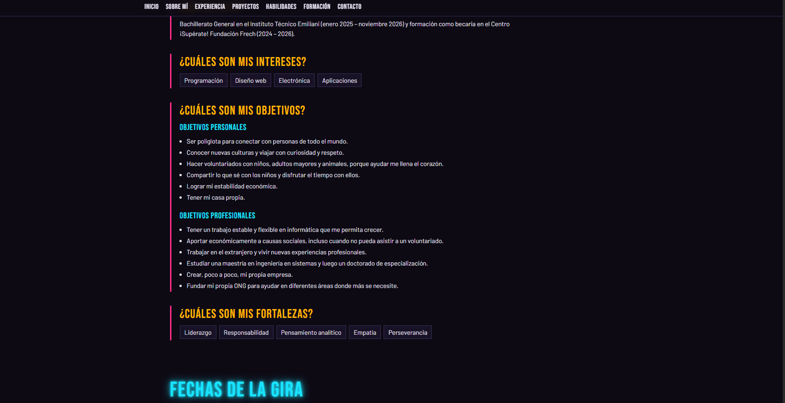

# Portafolio rock de los 80 · Xochitl Delgado

Portafolio digital de **Xochitl Lisbeth Delgado Cano**, bachiller y becaria del Centro ¡Supérate! Fundación Frech. Reúne mi presentación, mi experiencia, mis habilidades y los proyectos de algoritmos, Machine Learning y desarrollo web que trabajé durante las 10 semanas del curso.

El diseño tiene tema de **rock de los 80**: letreros de neón, el setlist como lista de proyectos (Lado A y Lado B) y el contacto como pase de backstage.



## Contenido

El portafolio tiene las siete secciones obligatorias:

1. **Inicio:** nombre, fotografía, carrera, frase de presentación, botones de navegación y enlace a GitHub.
2. **Sobre mí (Backstage):** quién soy, qué estudio, intereses, objetivos personales y profesionales, y fortalezas.
3. **Experiencia (Fechas de la gira):** trabajo, proyectos, hackathon, voluntariado y actividades extracurriculares.
4. **Proyectos (Setlist):** cada proyecto tiene su propia página con problema, objetivo, tecnologías, solución, resultados, capturas, archivos descargables y código fuente.
5. **Habilidades (Equipo en el escenario).**
6. **Formación académica (Discografía académica).**
7. **Contacto (Pase de backstage):** correo y formulario con validaciones conectado a una API REST.

### Proyectos documentados

| Proyecto | Qué hice |
| --- | --- |
| Regresión lineal (Semana 3) | Modelo que predice el puntaje según las horas de estudio, con R² de 0.9821. |
| Laberinto (Semana 4) | Juego en Pygame: el mapa se genera con DFS y la ruta más corta se calcula con BFS. |
| AI Challenge: K-Means y KNN | Agrupación y clasificación de 500 estudiantes simulados, con y sin normalización. |
| Hotspots comerciales | Análisis de las sucursales de Wendy's de San Salvador con K-Means y KNN con distancia Haversine. Proyecto grupal. |
| Ingenia (ExpoTech) | Plataforma web que conecta a albañiles con clientes y ferreterías aliadas, con registro, verificación por correo y OCR del DUI. |
| App web y backend | Este portafolio: Next.js, componentes React y la API `POST /api/contact`. |

## Tecnologías utilizadas

- **Next.js** (App Router): framework principal, rutas dinámicas y generación estática.
- **React** y **TypeScript**: interfaz y tipado.
- **Tailwind CSS**: estilos, junto con CSS propio para el efecto neón.
- **Google Fonts** con `next/font`: Monoton, Bebas Neue y Barlow.
- **Git y GitHub**: control de versiones.
- **Vercel**: despliegue.
- En los proyectos de Python: pandas, NumPy, scikit-learn, Matplotlib, Pygame, folium, Streamlit y Jupyter Notebook.

## Estructura del proyecto

```
app/
  page.tsx                  Página principal con las siete secciones
  layout.tsx                Tipografías y metadatos
  globals.css               Paleta, efecto neón y botones
  proyectos/[slug]/page.tsx Página de detalle de cada proyecto
  api/contact/route.ts      API REST: POST /api/contact
components/
  ContactForm.tsx           Formulario con validación en el navegador
  CodeViewer.tsx            Muestra el código fuente de cada proyecto
lib/
  data.ts                   Todo el contenido del portafolio
public/
  xochitl.jpg               Fotografía
  proyectos/<proyecto>/     Código, gráficas, datasets, notebook, mapa e informe
```

El contenido (perfil, proyectos, experiencia, habilidades y formación) vive en `lib/data.ts`. Para agregar o editar un proyecto se cambia ese archivo y se guardan sus archivos en `public/proyectos/<slug>/`.

## API REST

`POST /api/contact` recibe un JSON con `nombre`, `correo` y `mensaje`.

| Caso | Respuesta |
| --- | --- |
| Datos válidos | `200` con `{ "message": "..." }` |
| Nombre, correo o mensaje inválidos | `422` con `{ "error": "..." }` |
| El cuerpo no es JSON | `400` con `{ "error": "..." }` |

Las reglas son: nombre de al menos 2 caracteres, correo con formato válido y mensaje de 10 a 2000 caracteres. El navegador valida primero y el servidor vuelve a validar.

## Instalación

Requisitos: **Node.js 20 o superior** y **Git**.

```bash
git clone https://github.com/Xoch2026/Portafolio-Digital.git
cd Portafolio-Digital
npm install
```

## Ejecutar el proyecto

```bash
npm run dev
```

Abre http://localhost:3000.

Para probar la versión de producción:

```bash
npm run build
npm start
```

### Variables de entorno

Por ahora el proyecto no necesita ninguna. Si más adelante conecto un servicio de correo (por ejemplo Resend), la clave va en un archivo `.env.local`, que no se sube a GitHub, y también en la configuración del proyecto en Vercel.

### Ejecutar los proyectos de Python

```bash
pip install pandas numpy scikit-learn matplotlib pygame
python public/proyectos/regresion-lineal/regresion_lineal.py
python public/proyectos/kmeans-knn/ai_challenge_kmeans_knn.py
python public/proyectos/laberinto/laberinto.py
```

La aplicación de Hotspots lee sus datos desde su propia carpeta, así que se ejecuta desde ahí:

```bash
cd public/proyectos/hotspots-comerciales
pip install -r requirements.txt
streamlit run app.py
```

## Despliegue

El repositorio está conectado a Vercel, que detecta Next.js y publica el sitio en cada `git push`.

## Lo que aprendí

- **Next.js y React:** a organizar una página con App Router, a generar una página por proyecto desde un solo archivo de datos y a separar los componentes que corren en el servidor de los que necesitan estado en el navegador, como el formulario.
- **API REST:** a validar los datos dos veces, en el navegador y en el servidor, y a responder con el código correcto: 200, 400 o 422.
- **Machine Learning:** que normalizar los datos importa mucho en KNN (con k = 21 la exactitud fue de 0.912 con normalización y 0.696 sin ella), que K-Means encuentra grupos sin etiquetas y que las coordenadas se miden mejor con la distancia Haversine que en línea recta.
- **Algoritmos:** que DFS sirve para construir un laberinto y BFS para encontrar el camino más corto.
- **Trabajo con Git:** a llevar el proyecto en un repositorio propio con commits descriptivos.

## Autora

Xochitl Lisbeth Delgado Cano · [GitHub](https://github.com/Xoch2026) · xomerino1309@gmail.com
